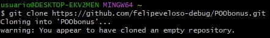
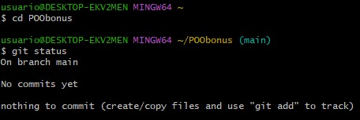
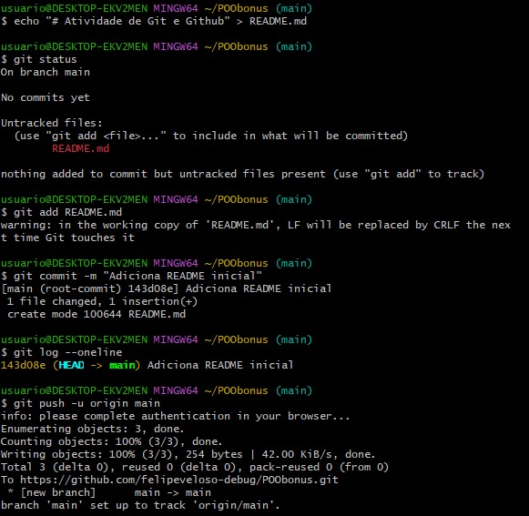
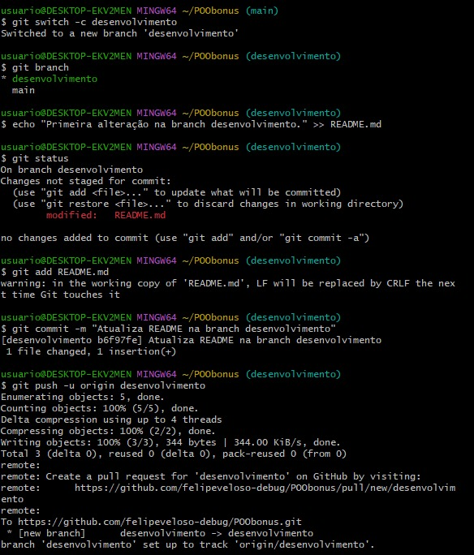
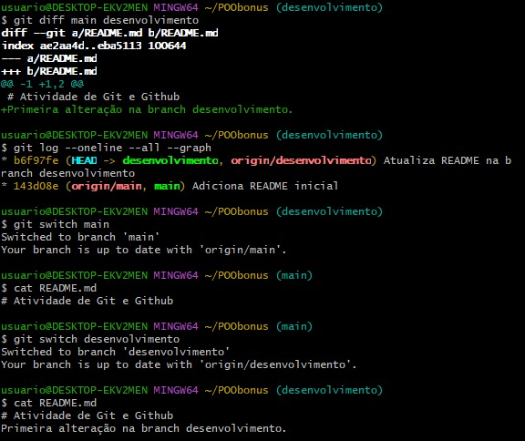

# Relatório — Atividade Prática de Git e GitHub

**Repositório:** [POObonus](https://github.com/felipeveloso-debug/POObonus)

## 1. Objetivo

Demonstrar a utilização dos principais recursos do Git e do GitHub, incluindo clonagem de repositórios, controle de versões por commits, envio de alterações ao repositório remoto e utilização de branches.

## 2. Clonagem do repositório

Foi utilizado o comando `git clone` para criar uma cópia local do repositório remoto. Em seguida, entrei na pasta clonada e executei `git status` para verificar o estado inicial do repositório.

**Comandos utilizados:**

```bash
git clone https://github.com/felipeveloso-debug/POObonus.git
cd POObonus
git status
```






## 3. Criação de arquivo e primeiro commit

Foi criado o arquivo `README.md` com um título inicial. Em seguida, utilizei `git status` para verificar o arquivo não rastreado, `git add` para prepará-lo e `git commit` para registrar a primeira versão.

O comando `git log --oneline` permitiu verificar o commit criado. Por fim, utilizei `git push -u origin main` para enviar as alterações ao GitHub.

**Comandos utilizados:**

```bash
echo "# Atividade de Git e Github" > README.md
git status
git add README.md
git commit -m "Adiciona README inicial"
git log --oneline
git push -u origin main
```

O primeiro commit foi identificado pelo código `143d08e`.




## 4. Criação e alteração de uma branch

Foi criada a branch `desenvolvimento` a partir da branch `main`, utilizando `git switch -c`. Nessa nova branch, foi adicionada uma linha ao arquivo `README.md`, e a alteração foi registrada em um novo commit.

Depois, a branch foi enviada ao GitHub por meio de `git push -u origin desenvolvimento`.

**Comandos utilizados:**

```bash
git switch -c desenvolvimento
git branch
echo "Primeira alteração na branch desenvolvimento." >> README.md
git status
git add README.md
git commit -m "Atualiza README na branch desenvolvimento"
git push -u origin desenvolvimento
```

O segundo commit foi identificado pelo código `b6f97fe`.




## 5. Comparação de versões e histórico de commits

Utilizei `git diff main desenvolvimento` para comparar os arquivos das duas branches e identificar a linha adicionada em `desenvolvimento`.

O comando `git log --oneline --all --graph` exibiu o histórico dos commits e suas respectivas branches. Por fim, utilizei `git switch` para alternar entre `main` e `desenvolvimento` e `cat README.md` para verificar o conteúdo do arquivo em cada versão.

**Comandos utilizados:**

```bash
git diff main desenvolvimento
git log --oneline --all --graph
git switch main
cat README.md
git switch desenvolvimento
cat README.md
```

A comparação demonstrou que a branch `main` mantém o conteúdo inicial, enquanto `desenvolvimento` contém a alteração adicional.




## 6. Conclusão

A atividade permitiu praticar a clonagem de um repositório, o acompanhamento de alterações, a criação de commits, o envio de versões ao GitHub e o uso de branches para manter modificações separadas.

Os comandos e as capturas de tela apresentados documentam as operações realizadas e demonstram a existência de dois commits e das branches `main` e `desenvolvimento`.
